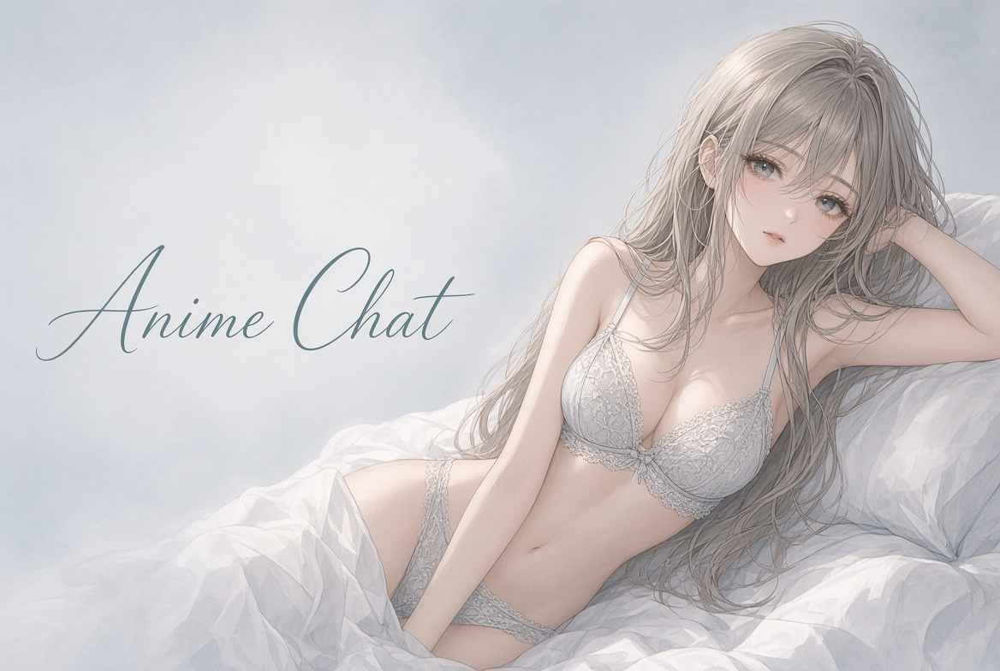
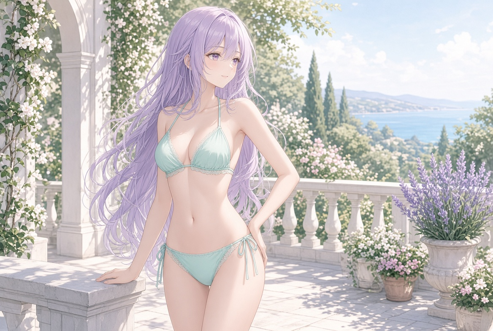
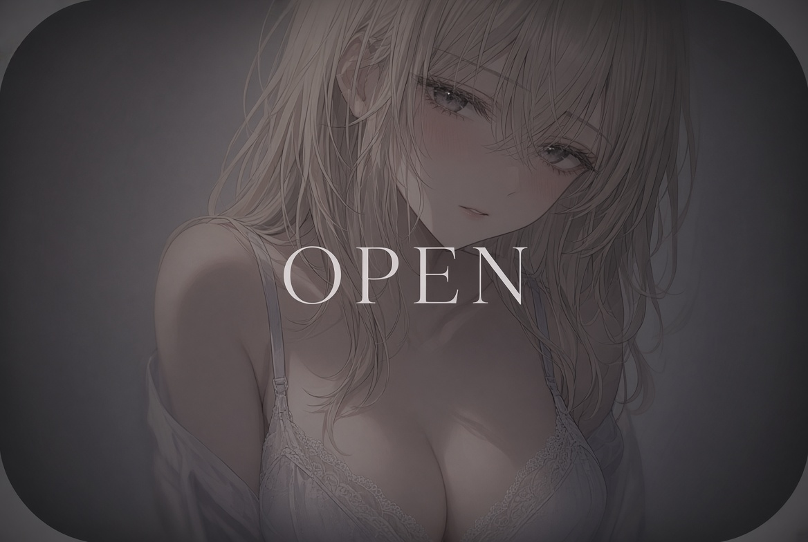

# Anime Chat

A calm look at browser tools where you can open an anime-style character and talk with fewer content filters than the main ChatGPT site. Promo codes are common on paid plans. Free start is short. Check the live page for current limits.

[Open Anime Chat](https://chubby-gf.com/animechat)

---

## What you can do

Pick a ready anime-style character or build one. Set a name, a look and a short background. Send messages. Stay in the same thread if you want earlier details to come back. Pictures of the character and voice replies usually unlock on paid plans. Most sites ask you to confirm age.

“Without filters” on these tools usually means the character chat itself has fewer restrictions. It does not mean unlimited free messages. Media still uses a meter on most plans.

---

## How people start

Open the site. Choose one character or start the builder. Send a few messages. If the tone fits, stay in that chat. If it does not, close the tab. The free tier is the test.

Paid plans usually add more messages, images and voice. Memory is better on paid. First-month discounts and promo codes are common. The renewal price is the number that matters.

---

---

## Plans and promo

| | Free | Paid |
| --- | --- | --- |
| Messages | Few | Higher or unlimited |
| Characters | Limited | More |
| Images | Limited or none | Available |
| Voice | Limited or none | Available |

Promo codes often appear on the plan page or in the account. They usually apply to the first month or the yearly plan. Open the site and read the current offer before you enter a card.

[See plans](https://chubby-gf.com/animechat)

---

## What to check

- How many free messages you get.  
- What the paid plan actually adds.  
- Whether a promo code is active and what it covers.  
- Whether you can cancel from the account page.  
- Do not put real names or phone numbers in the chat.

A couple of days of free use shows if the character holds the conversation. After that it is about media and how long you want to stay.

---

---

## Who it fits

People who want an anime-style character they can open and talk to.  
People who prefer one thread they can return to.  
People who are fine testing free before paying.  
People who may want images or voice later.

It is less useful if you only need a general chatbot with no character.

---

anime chat · anime chat without filters · ai companion · browser ai chat · custom character · promo code · ai chat platforms · virtual companion

  

Independent page. Prices and features change. Check the live site.
